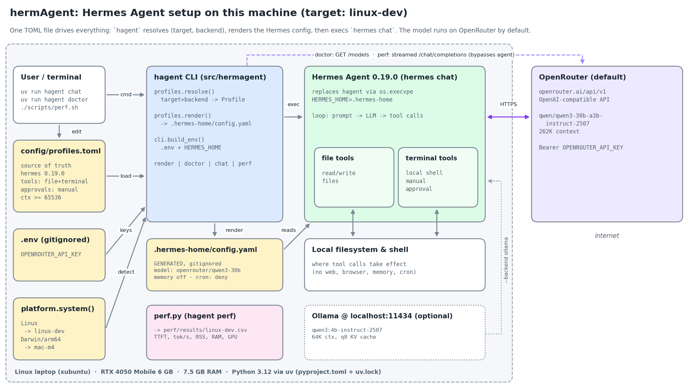

# hermAgent

Reproducible [Hermes Agent](https://github.com/NousResearch/hermes-agent) setup: develop on Linux, deploy on a Mac mini (M4 Pro, 24 GB).

## Architecture



Regenerate with `uv run --no-project --with matplotlib==3.10.0 python scripts/architecture.py`.

```
hagent --target <hw> --backend <llm> chat
   │
   ├─ config/profiles.toml ──render──▶ .hermes-home/config.yaml   (generated, gitignored)
   │      targets:  linux-dev | mac-m4      (auto-detected from OS/arch)
   │      backends: openrouter (default) | ollama (optional)
   │
   └─ exec hermes chat  (HERMES_HOME=.hermes-home, secrets from .env)
          tools: file + terminal only · approvals: manual · cron: deny
          │
          ├─▶ OpenRouter  qwen/qwen3-30b-a3b-instruct-2507   (262K ctx)
          └─▶ Ollama      qwen3:4b-instruct-2507 @ localhost:11434 (64K ctx)
```

Hermes 0.19 needs a context window of at least 64K tokens, and every backend here meets that.

## Tech stack

| Layer | Choice |
|---|---|
| Runtime | Python 3.12, `uv` (`pyproject.toml` + `uv.lock`) |
| Agent | `hermes-agent==0.19.0` |
| LLM | OpenRouter (hosted); Ollama (local, optional) |
| Wrapper | `hagent` CLI (`src/hermagent/`) |
| Tests | `pytest` (offline by default; `-m live` hits the model) |
| Perf | `scripts/perf.sh` → `perf/results/<target>.csv` |

## Run it

```bash
./scripts/setup.sh                 # uv sync --frozen, create .env, render config, run tests, run doctor
$EDITOR .env                       # OPENROUTER_API_KEY=sk-or-...
uv run hagent doctor               # all ✓?
uv run hagent chat                 # interactive agent (target auto-detected)
uv run hagent chat -q "hi" -Q      # one-shot
```

| Task | Command |
|---|---|
| Pick target/backend | `uv run hagent --target mac-m4 --backend ollama chat` |
| Local model (Mac) | `./scripts/ollama-mac.sh`, then `uv run hagent --backend ollama chat` |
| Log performance | `./scripts/perf.sh --runs 5` (or `BACKEND=ollama ./scripts/perf.sh`) |
| Tests | `uv run pytest` · live: `uv run pytest -m live` |

Docs: [`docs/process-log.md`](docs/process-log.md) (from idea to deployment) · [`docs/linkedin-article.md`](docs/linkedin-article.md)
