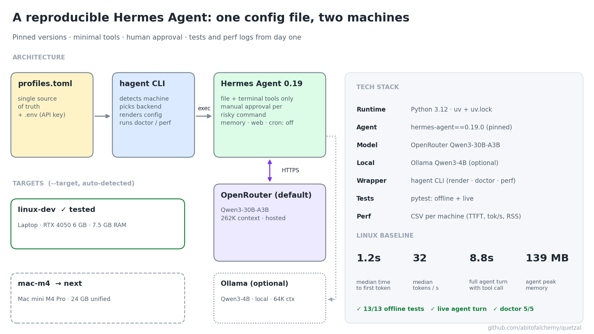
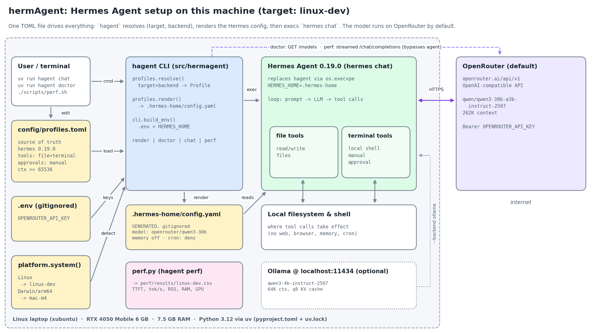

# I set up an AI agent you can rebuild from scratch in one command. Here's how.



Most "I installed an AI agent" posts end with "works on my machine." I wanted the opposite: an agent I could wipe and rebuild identically on a Linux laptop and on a Mac mini.

**The agent:** Hermes Agent by Nous Research, an open-source, terminal-based AI agent.

**The rules I set:**
1️⃣ Pin everything: agent version, Python version, model ID.
2️⃣ Minimal tools: file and terminal only, and every risky command needs my approval.
3️⃣ One config file, two machines.
4️⃣ Tests and performance logs from day one.

**The stack**
• Python 3.12 managed by uv (from Astral), with a lockfile committed to git
• hermes-agent 0.19.0, pinned
• OpenRouter for the model (Qwen3-30B-A3B), with Ollama as a local option
• pytest for tests, plus a CSV performance log for each machine

**The trick: separate the hardware from the model.**
One flag picks the machine (`--target linux-dev | mac-m4`), and another picks where the model runs (`--backend openrouter | ollama`). The machine is detected automatically, so the same command runs on both.

**The gotcha that cost me a model choice:**
Hermes refuses any model with less than 64K tokens of context, because its tool descriptions and system prompt take up a large fixed share of every request. My first pick, Qwen3-14B, offers only 41K on OpenRouter, so I switched to Qwen3-30B-A3B (262K context, about $0.10 per million input tokens). For local runs, Ollama has to be started with `OLLAMA_CONTEXT_LENGTH=65536`, or tool calls quietly break.

**Rebuild from zero:**
```
git clone https://github.com/abitofalchemy/quetzal && cd quetzal/hermAgent
./scripts/setup.sh        # install, render config, run tests, run health check
uv run hagent chat
```
Here is what you should expect to see:


### Prototype Box 

| Param | Description |
|---|---|
| **Model** | MSI Thin GF63 12VE |
| **OS** | Ubuntu 26.10, kernel 7.3.0-9 |
| **CPU** | Intel Core i5-12450H: 8 cores, 12 threads |
| **RAM** | 7.5 GiB, no swap |
| **GPU** | NVIDIA RTX 4050 Laptop, 6 GB VRAM (driver 580.178.04), plus Intel UHD integrated graphics |
| **Disk** | 112 GB root, 85 GB free |
| **Tooling** | Python 3.12 via uv 0.13.6 (system Python is 3.14.8) |

**Testing it before I move it (Linux laptop, RTX 4050, 7.5 GB RAM)**
1. `uv run pytest -q` → 13/13 offline tests pass
2. `uv run hagent doctor` → 5/5 checks pass (binary, key, backend, model, config)
3. A live agent turn: Hermes calls the terminal tool, I approve, it answers
4. `./scripts/perf.sh` → logs to a CSV for each machine

Linux baseline on OpenRouter: about 1.2 s to the first token, about 32 tokens/s, 8.8 s for a full agent turn that includes a tool call, and 139 MB peak memory for the agent. The model runs remotely, so the laptop barely notices.

**Diagrams as code, too**
The architecture figure above is a small matplotlib script in the repo, built from the same config the agent uses. When the setup changes, I re-run the script and the picture stays accurate.

Below is a high-level architectural view:


**Lessons**
→ Read the agent's source before choosing a model; the 64K minimum isn't on any model card.
→ Generate the agent's config from a tracked file instead of hand-editing it.
→ Log performance from day one, so moving to new hardware gets measured instead of guessed.
→ Set up credentials before you need them: my first push failed because the laptop had no GitHub login, and `gh auth login` with a one-time device code fixed it in a minute.

Results (Linux vs. M4 Pro): coming in the next post.

#AIagents #Python #uv #OpenSource #LLM #DevOps #Reproducibility
